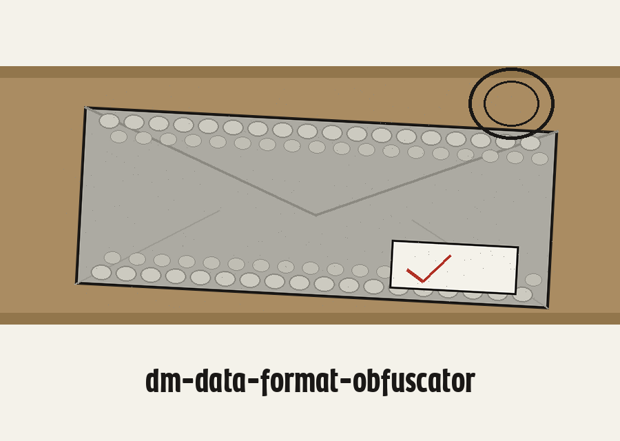
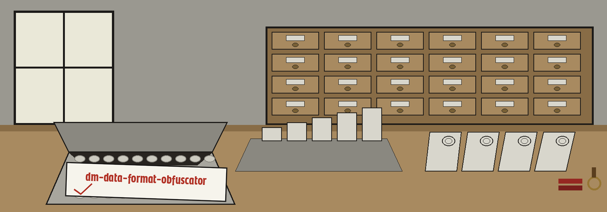

# dm-data-format-obfuscator

Title block: the name above is set in Caacupe One in ink black, in catalogue form, author first, with a small round date stamp vignette parked at the left edge of the block and the padded envelope shown in miniature beside this earliest heading only. Headings further down keep the catalogue dress and a ruled line and go without the vignette.

# dm-data-format-obfuscator
Transforms data into a visually similar but structurally different format to prevent direct interpretation. For example, converting JSON to XML with scrambled field names, or changing date formats unpredictably. - Focused on Tools designed to generate or mask sensitive data with realistic-looking but meaningless values

## Install
`git clone https://github.com/ShadowGuardAI/dm-data-format-obfuscator`

> Loan slip: the install line in this README spells the organisation without its hyphen. The slip records the spelling as printed. The website corrects it and labels the correction.

## Usage
`./dm-data-format-obfuscator [params]`

## Parameters
- `-h`: Show help message and exit
- `-i`: Path to the input file.
- `-o`: Path to the output file.
- `-t`: Type of transformation to apply (json_to_xml, date_obfuscation).

> Loan slip: dates are expected in one named format only, the year month day order the parameters and behavior notes name with its percent sign format string.

## Behavior notes
- The output file may not be the input file. If the resolved output path is the input file, by the same spelling or through a symlink, the run refuses at exit 1 before anything is written and the input is left untouched.
- A date_obfuscation run counts the dates it actually rewrites. If no value in the input is a date in the expected %Y-%m-%d form, the run prints "No dates were found or rewritten.", exits 1, writes no output file, and does not print the completion line.

> Loan slip: the output may not resolve to the input. If it does, by the same spelling or through a symlink, the run refuses at exit 1 before anything is written and the input stays untouched.

> Loan slip: a date run that rewrites nothing reports "No dates were found or rewritten.", exits 1, and writes nothing.

## License
Copyright (c) ShadowGuardAI

## Loan slips gathered at the table end

The main button of this re-skin reads Transform the File. Its type field label reads Transformation Type. Its refusal heading reads The Output Is Never the Input. Its empty run heading reads Nothing Rewritten, Nothing Written. Closing: the envelope is sealed and sits alone at the table end, postmark ringed, label ticked. The catalogue drawers stay shut behind it. The room returns to stillness with the parcel gone from it.
